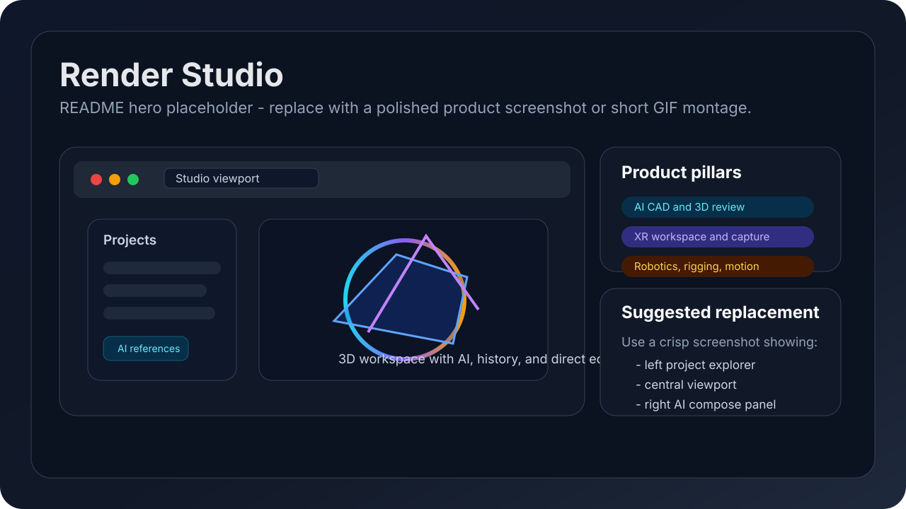
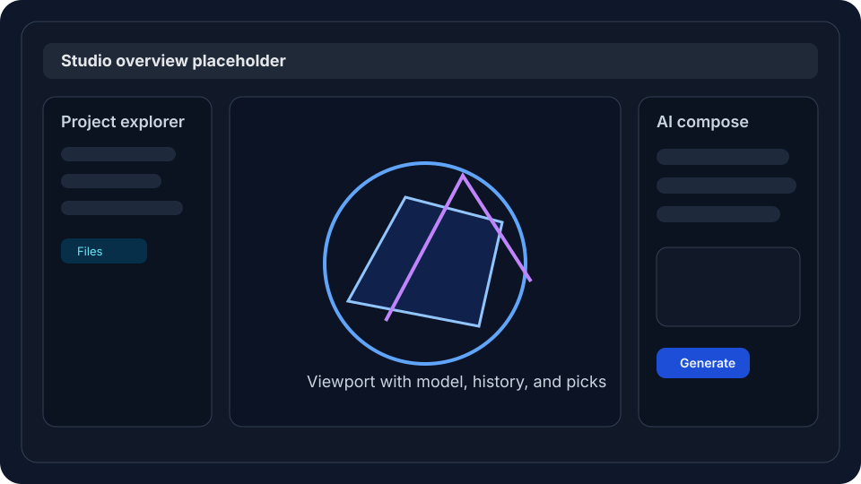
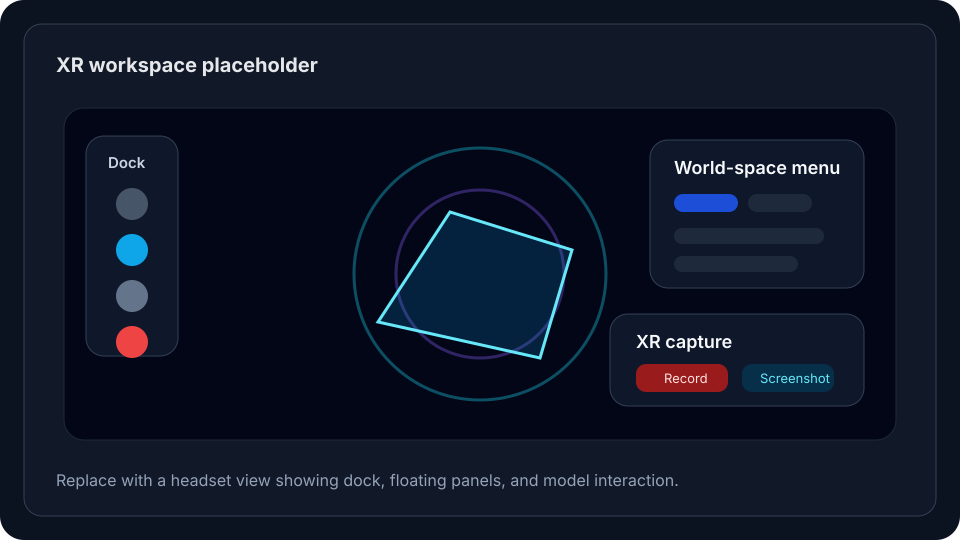
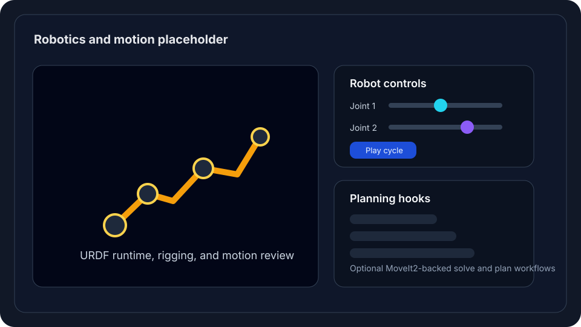

# Render Studio




Render Studio is an AI-native 3D design studio for teams building physical products, robotics workflows, and immersive review experiences. It brings prompt-based CAD generation, a real-time 3D viewport, VR/XR interaction, wiring and motion tools, cloud CAD bridges, and guided in-product help into one product surface.

If you want the two-minute version:

- **Describe parts in plain English** and generate or revise geometry inside the project.
- **Work directly in a live 3D studio** with history, picks, transforms, sectioning, markup, and exports.
- **Review models in XR** with Quest controllers, world-space panels, capture tools, and VR-specific controls.
- **Move into robotics workflows** with rigging, URDF/SRDF outputs, a robot runtime, and optional MoveIt2 planning hooks.
- **Keep the learning loop inside the app** through Getting Started guides, full docs, a Quest Book, and Render Agent help.

## Who this is for

| Team | Why Render Studio fits |
|------|------------------------|
| Founders building physical-product demos | Move from idea to a reviewable 3D concept without switching between six tools. |
| Product and mechanical engineers | Combine prompt-driven iteration with direct viewport edits, references, sketches, and export paths. |
| Robotics teams | Author geometry, review rigging and joints, and work with robot-ready artifacts in the same project. |
| Design and innovation teams | Use XR review, markup, collaboration, and guided onboarding to shorten design feedback loops. |

## What ships today

| Capability | What it does |
|------------|--------------|
| **AI CAD & prompt loop** | Generate parts from natural language, revise with follow-ups, use geometry picks, and run parallel generations. |
| **Studio viewport** | Orbit, section, transform, measure, inspect history, and manage model visibility in a Three.js-based workspace. |
| **Workspace modes** | Switch between Design, Architect, and Wiring Simulator; Simulation and Manufacture are present but not yet enabled. |
| **Sketch, Draw, and feature editing** | Use constrained sketching, direct face/path edits, and a parametric feature-history editor. |
| **VR/XR review** | Enter WebXR, use Quest-style controls, open world-space panels, capture screenshots/video, and review the same project in headset. |
| **Robotics & motion** | Rig assemblies, load URDF/SRDF artifacts, simulate robot motion in the viewport, and optionally connect MoveIt2. |
| **Cloud CAD bridges** | Import/export with Fusion and Onshape workflows, plus standard GLB/STL/STEP/3MF paths. |
| **Guided learning & agents** | Use in-app docs, Getting Started guides, Quest Book progression, Skills, and Render Agent assistance. |

## Product views

| Studio overview | XR review | Robotics workflows |
|---|---|---|
|  |  |  |

## Quick start

### Fastest working path

The repository currently assumes a provisioned Python environment. The quickest working setup is:

```bash
git clone https://github.com/wprojects/Render-Studio.git
cd Render-Studio
cp .env.example .env
# Set at least one model key, for example OPENAI_API_KEY or ANTHROPIC_API_KEY
source /home/ubuntu/.venv/bin/activate
python run.py
```

Then open:

- **Dev server:** `http://127.0.0.1:8000`
- **Health check:** `http://127.0.0.1:8000/api/health`

### Important setup note

This checkout does **not** currently include a top-level pinned Python dependency manifest such as `requirements.txt` or `pyproject.toml`. For a fresh machine bootstrap, start from a known-good provisioned environment or export the active dependency set before expecting `python run.py` to work on a clean host.

More detail: [docs/getting-started.md](docs/getting-started.md)

## First five minutes in the app

1. Create a project and set your units.
2. Drop in a STEP, GLB, DXF, PDF, or image reference.
3. Open the AI Compose panel and generate or revise a model.
4. Switch tabs for SOLID, SKETCH, RIGGING, ELECTRONICS, ROBOTICS, or CANVAS work.
5. Open the in-product guides at `getting-started.html` or `docs.html`.

## Architecture at a glance

Render Studio is a thin-static frontend plus a Python backend with a real CAD kernel behind it.

- **Frontend:** `frontend/index.html`, `frontend/app.js`, `frontend/styles.css`, and many focused modules.
- **Backend:** `backend/main.py` plus domain services under `backend/services/`.
- **CAD kernel:** `backend/kernel/` uses build123d and OpenCASCADE for parametric B-rep work.
- **XR & graphics:** Three.js, WebXR, and viewport-specific modules for capture, rigging, and interaction.
- **Docs & onboarding:** `frontend/docs-features.js` feeds in-product docs, Quest Book, tours, and agent help.

Deep dive: [docs/architecture.md](docs/architecture.md)

## Documentation map

- [Getting Started](docs/getting-started.md)
- [Architecture](docs/architecture.md)
- [Studio, workspaces, and XR](docs/studio-and-xr.md)
- [Robotics, motion, and teleop hooks](docs/robotics-and-motion.md)
- [Contributing and deploy-sync notes](docs/contributing.md)
- [Docs index](docs/README.md)

## In-product learning surfaces

When the app is running, these pages are part of the product:

- `http://127.0.0.1:8000/getting-started.html`
- `http://127.0.0.1:8000/docs.html`
- `http://127.0.0.1:8000/roadmap.html`
- `http://127.0.0.1:8000/updates.html`

## Repo highlights

- `frontend/docs-features.js` is the best single summary of shipped user-facing capabilities.
- `frontend/workspace-modes.js` shows which workspaces are live today.
- `frontend/viewport-xr.js` powers the XR workflow.
- `frontend/rigging-editor.js`, `frontend/robotic-simulator.js`, and `frontend/urdf-robot-runtime.js` anchor the robotics path.
- `backend/kernel/` holds the parametric kernel contract.

## Roadmap

The repo already ships a substantial product, but a few items are still clearly in-progress or planned:

- **Full local-machine bootstrap docs and a pinned root dependency manifest**
- **STEP/IGES import expansion**
- **Richer feature-tree UX around the existing parametric kernel**
- **Broader multi-part assembly and BOM workflows**
- **Simulation and Manufacture workspaces beyond their current disabled placeholders**

See also: `frontend/roadmap.html` in the running app.

## Security

Never commit `.env`, secrets, or OAuth credentials. If a key leaks into logs or chat, rotate it immediately.
