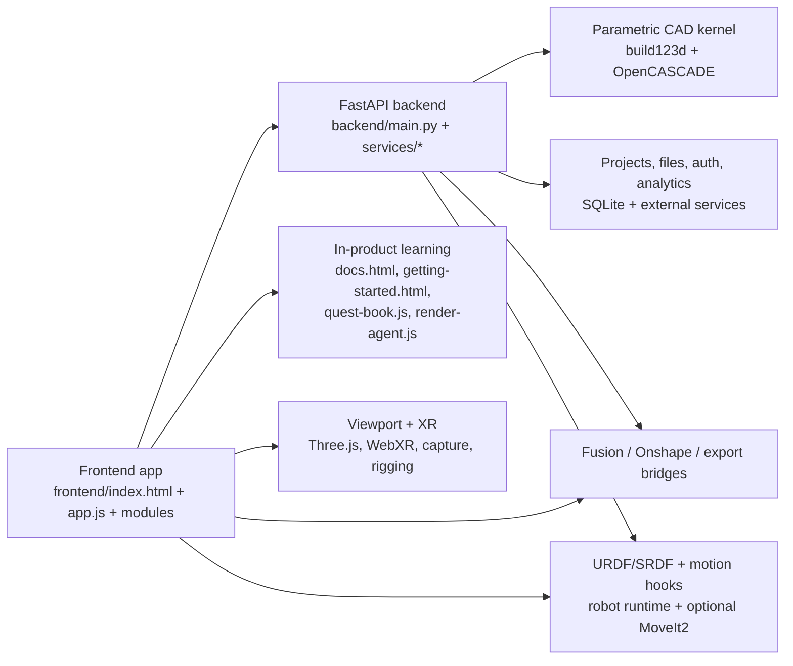

# Architecture

Render Studio is a browser-based product with a thin static frontend, a Python API backend, and a parametric CAD kernel behind the generation and editing loop.

## System shape

## Frontend

The frontend is served statically from `frontend/` with no bundler and no framework requirement in the main app shell.

### Core files

| Path | Role |
|------|------|
| `frontend/index.html` | Main Studio shell |
| `frontend/app.js` | Main boot and product wiring |
| `frontend/styles.css` | Shared product styling |

### High-signal feature modules

| Path | Role |
|------|------|
| `frontend/workspace-modes.js` | Top-level workspace mode switcher |
| `frontend/docs-features.js` | Canonical feature catalog for docs, guides, Quest Book, and agent help |
| `frontend/viewport-xr.js` | Quest/WebXR interaction model |
| `frontend/feature-editor.js` | Parametric feature-history editing |
| `frontend/rigging-editor.js` | Rigging and joint editing |
| `frontend/robotic-simulator.js` | Robot workspace and playback surfaces |
| `frontend/urdf-robot-runtime.js` | URDF/SRDF runtime inside the viewport |
| `frontend/render-agent.js` | In-product assistant and help launcher |

## Backend

The backend is a FastAPI app rooted in `backend/main.py`, with most behavior organized into domain services.

### Major backend areas

| Path | Role |
|------|------|
| `backend/main.py` | API routes and app-level integration points |
| `backend/services/` | Business logic for CAD, AI, projects, onboarding, exports, skills, analytics, and integrations |
| `backend/kernel/` | Parametric CAD kernel contract and builder |
| `backend/engineering/` | Engineering generators such as gears and enclosures |
| `backend/physics/` | URDF, simulation metadata, and motion-adjacent helpers |
| `backend/specs/` | Hardware spec data |
| `backend/skills/` | Skill packs and reference material for specialized generation flows |

## The CAD kernel

The repo's most important technical shift is that it no longer relies only on mesh-like placeholder geometry. The `backend/kernel/` package exposes a real parametric B-rep path using build123d and OpenCASCADE.

That matters because it enables:

- exact geometry instead of only view meshes
- feature-program rebuilds
- stronger STEP export paths
- higher-leverage downstream flows for design, revision, and manufacturing work

## Workspace model

The source currently exposes these workspace modes:

| Mode | Status |
|------|--------|
| `Design` | Enabled |
| `Architect` | Enabled |
| `Wiring Simulator` | Enabled |
| `Simulation` | Present, not enabled |
| `Manufacture` | Present, not enabled |

Inside the design experience, the app also exposes tabs such as SOLID, SKETCH, RIGGING, ROBOTICS, ELECTRONICS, INSERT, CATALOG, TEXTURE, and CANVAS.

## XR and immersive review

XR is not bolted on as a separate prototype. It is wired into the main viewport stack:

- Quest-style controller affordances
- left-hand tool dock
- world-space project and AI panels
- screenshot and recording actions
- shared project context with the rest of the Studio

The main implementation anchor is `frontend/viewport-xr.js`.

## Robotics and motion path

Render Studio already ships several robotics-facing building blocks:

- rigging editor
- robot simulator tabs and environments
- URDF/SRDF generation and playback
- viewport runtime for articulated assets
- optional MoveIt2 pose solving and planning hooks

What it does **not** ship today is a standalone teleoperation control plane. The closest real surface is robot runtime plus optional motion-planning integration.

## Docs and onboarding architecture

One repo detail matters more than it first appears: the docs system is structured, not ad hoc.

`frontend/docs-features.js` acts as the feature manifest for:

- `docs.html`
- `getting-started.html`
- `quest-book.js`
- `render-agent.js`
- guided tours via `show-me-tour.js`

That means documentation, onboarding, and guided help are product features with shared source data, not just static copy.

## Runtime model

### Development

- `run.py` starts `uvicorn` in reload mode
- default dev address comes from `.env.example`: `127.0.0.1:8000`

### Production

- deployment runs `uvicorn backend.main:app` behind systemd and Caddy
- production service uses port `8001`
- the live product serves the same static frontend directly from `frontend/`

## Read next

- [Getting Started](getting-started.md)
- [Studio, workspaces, and XR](studio-and-xr.md)
- [Robotics, motion, and teleop hooks](robotics-and-motion.md)
- [Contributing and deploy-sync notes](contributing.md)
