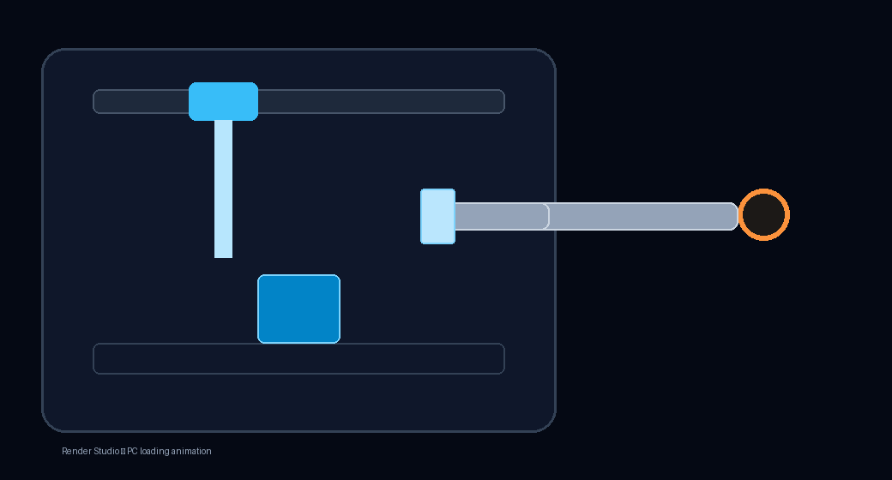

# Render Studio Cloud

Public cloud profile for Render Studio.

## What you get

- Product name: **Render Studio**
- Default project visibility: **private** (users can still publish)
- Marketplace enabled
- **Automatic update publishing ON → docs only**

Slack / Discord / LinkedIn stay off until you add secrets and flip the toggles
in **Management → Server Settings**. Those toggles live in local `data/` so a
`git pull` will not reset them.

## Update publishing

See [UPDATE-PUBLISHING.md](../../docs/UPDATE-PUBLISHING.md) on the trusted release branch.

The profile ships an example update log under `updates/UPDATE-LOG.md`. Local
servers copy it once into `data/server-config/updates/UPDATE-LOG.md`.

## Screenshots

